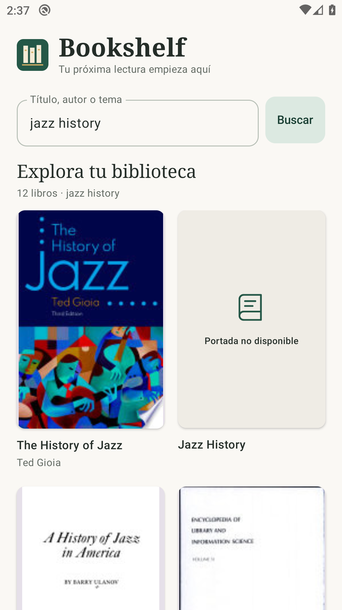
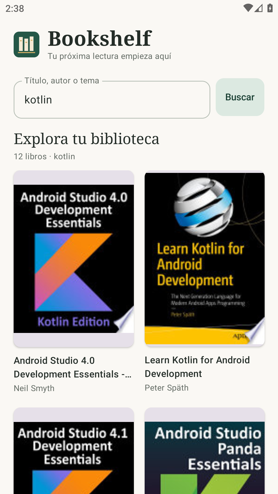
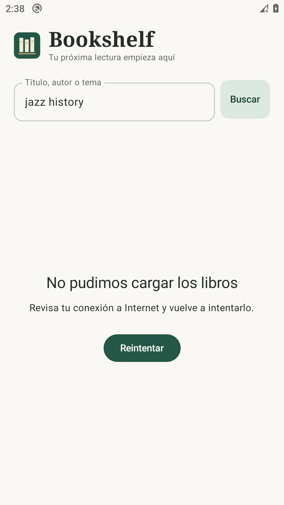

# Bookshelf App

Aplicación Android con **Kotlin y Jetpack Compose** desarrollada para el codelab [Project Create a Bookshelf App](https://developer.android.com/codelabs/basic-android-kotlin-compose-bookshelf) de Android Developers.

Busca libros en **Google Books**, consulta los detalles de cada volumen mediante **Retrofit**, convierte las respuestas JSON con **Gson** y carga las portadas con **Coil** en una cuadrícula vertical adaptable. Incluye estados de carga, lista vacía, error de red y reintento.

## Documento y evidencias

- [Informe editable en Word](docs/Evidencias_Bookshelf.docx)
- [Informe en PDF](docs/Evidencias_Bookshelf.pdf)
- [Validación y resultados de las pruebas](docs/Validacion.md)
- [Capturas originales y huellas SHA256](screenshots/manifest.json)

| Galería de Google Books | Búsqueda de Kotlin | Error sin conexión |
| :---: | :---: | :---: |
|  |  |  |

Capturas reales del emulador **Cupcake_API29**, realizadas el **18 de noviembre de 2026**. [Procedimiento de captura](screenshots/README.md).

Verificación: **13 pruebas unitarias y 5 pruebas instrumentadas correctas**; compilación completada y Android Lint sin errores. Los registros están incluidos en `docs`.

## Arquitectura

```text
BookshelfApplication
 └─ DefaultAppContainer
     └─ NetworkBooksRepository ← BooksApiService / Retrofit / Gson
         └─ BooksViewModel
             └─ BookshelfApp
                 ├─ Loading
                 ├─ Success → LazyVerticalGrid → Coil
                 ├─ Empty
                 └─ Error → Reintentar
```

El repositorio recibe el servicio por constructor; el ViewModel recibe la interfaz `BooksRepository`. La actividad proporciona el ViewModel con una fábrica, de modo que conserva su estado al rotar. Las búsquedas nuevas cancelan la consulta anterior para evitar mostrar resultados atrasados.

El flujo usa `GET volumes?q=...&maxResults=12`, extrae los identificadores y realiza `GET volumes/{id}` para cada libro. Las portadas `http://` se convierten a `https://`; los libros sin portada presentan un indicador accesible. Cada búsqueda realiza hasta 13 consultas de metadatos, además de las descargas de imágenes.

## Ejecutar

1. Clonar este repositorio y abrirlo en Android Studio.
2. Usar **JDK 17**, Android SDK 35 y un dispositivo **API 24 o superior**.
3. Crear una clave en [Google Cloud Console](https://console.cloud.google.com/apis/credentials), habilitar **Books API** y restringir la clave a esa API.
4. Añadir al archivo local `local.properties`:

   ```properties
   sdk.dir=C\:\\Users\\TU_USUARIO\\AppData\\Local\\Android\\Sdk
   BOOKS_API_KEY=TU_CLAVE_LOCAL
   ```

   También se admite la variable de entorno `GOOGLE_BOOKS_API_KEY`, que tiene prioridad. `local.properties` está excluido de Git. No subir claves, archivos BuildConfig generados ni APK que contengan una clave personal.

5. Sincronizar Gradle y ejecutar la aplicación. Al iniciar se consulta `jazz history`; el campo de búsqueda permite cambiar el tema.

Las consultas sin clave pueden devolver **HTTP 429**. En ese caso la app muestra el error y permite reintentar; no sustituye respuestas de la API por datos ficticios. La [documentación de Google Books](https://developers.google.com/books/docs/v1/using#APIKey) explica la identificación de las solicitudes y las cuotas.

## Verificar

```powershell
.\gradlew.bat testDebugUnitTest assembleDebug lintDebug
.\gradlew.bat connectedDebugAndroidTest
```

Las pruebas unitarias ejercitan el repositorio real con **MockWebServer** y con un **FakeBooksApiService** sin conexión. También comprueban los estados del ViewModel mediante un repositorio inyectado. Las pruebas instrumentadas usan datos de prueba y verifican cuadrícula, desplazamiento, carga, búsqueda, lista vacía y recuperación con el botón de reintento. Esos datos están exclusivamente en los conjuntos `test` y `androidTest`.

Versiones: AGP 8.8.0, Gradle 8.12, Kotlin 2.1.0, Compose BOM 2024.12.01, Retrofit y Gson Converter 2.9.0, OkHttp 4.11.0 y Coil Compose 2.4.0.

## Autor

**Erick Alexander Moreira Bailón**

Ingeniería de Software · Aplicaciones Móviles Nativas · Sexto nivel

GitHub: [Erickelrojo-22](https://github.com/Erickelrojo-22)

Práctica basada en el codelab oficial de Android Developers. El diseño de la app y la implementación se prepararon para esta entrega. Los libros y portadas pertenecen a sus respectivos titulares y se muestran mediante Google Books.
